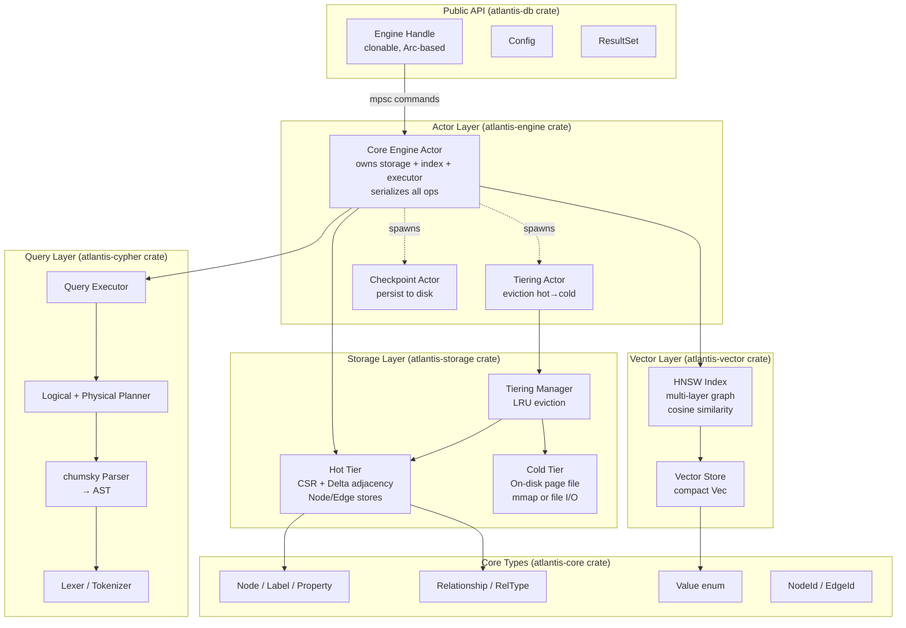

# Atlantis DB — Design

## Research Summary

Research was conducted on the following areas. Key findings inform the design below.

### HNSW Algorithm

Source: [rust-cv/hnsw implementation guide](https://github.com/rust-cv/hnsw/blob/master/implementation.md), [original HNSW paper (Malkov & Yashunin)](https://arxiv.org/abs/1603.09320)

- HNSW creates layers of Navigable Small World graphs. Top layers are sparse; the zero layer is fully connected.
- Layer assignment is probabilistic, approximating a skip list: `max_layer = -ln(unif(0,1)) * mL` where `mL = 1/ln(M)`.
- Key parameters:
  - **M**: neighbors to connect on insertion. Paper suggests 5–48. Default: 16.
  - **M0** (Mmax0): max connections at layer 0 = `2 * M`. Default: 32.
  - **ef_construction**: candidate pool size during insertion. 100–200 is a good default. Higher = better graph quality, slower insertion.
  - **ef_search**: candidate pool size during search. Higher = better recall, slower search. Default: 50, tunable per query.
- Distance metric: cosine similarity (normalized dot product) as default.

### chumsky Parser Combinators

Source: [chumsky GitHub](https://github.com/zesterer/chumsky), [chumsky guide](https://github.com/zesterer/chumsky/blob/main/guide/getting_started.md)

- Latest stable: 0.10.0 (a from-scratch rewrite based on 1.0.0 alpha work).
- PEG-based, supports all context-free grammars with backtracking.
- Composable: small parsers combine into larger ones via combinators (`map`, `then`, `or`, `repeated`, `delimited_by`, etc.).
- Type signatures get complex; use `impl Trait` to keep them manageable.
- Powerful error recovery — can continue parsing after errors for good diagnostics.
- Pairs with `ariadne` for rendering error messages with spans.

### CSR (Compressed Sparse Row) Graph Storage

Source: [petgraph CSR](https://strymon.systems.ethz.ch/ds2/petgraph/csr/struct.Csr.html), [raphy graph library](https://github.com/blucia0a/raphy)

- CSR uses three arrays: `offsets` (indexed by source node, stores start index in neighbors array), `neighbors` (edges), and optionally `edge_props`.
- Extremely cache-friendly: traversing a node's neighbors is a contiguous array slice.
- Challenge: incremental updates are expensive (requires rebuilding or shifting arrays).
- **Solution for Atlantis DB**: "CSR + delta" architecture. Main adjacency stored in CSR, rebuilt periodically. Recent insertions go to a delta log (hash map of `NodeId -> Vec<EdgeId>`). Reads consult both. A background compaction merges the delta into the CSR when the delta exceeds a threshold.

### Tokio Actor Pattern

Source: [Alice Ryhl's actors-with-tokio](https://github.com/Darksonn/ryhl.io/blob/master/content/blog/actors-with-tokio/index.md), [tokio channels tutorial](https://tokio.rs/tokio/tutorial/channels)

- An actor owns its data and runs in a single spawned tokio task.
- A clonable handle struct holds an `mpsc::Sender` — the public API.
- All communication via typed messages through the channel. No shared mutable state, no locks.
- Oneshot channels for request/response: send a command + a `oneshot::Sender<T>` for the reply.
- Pattern scales to multiple actors: each background task (tiering, checkpointing) is its own actor with its own channel.

### Existing Rust Graph Databases

Source: [CozoDB](https://github.com/cozodb/cozo), [frankengraphdb](https://github.com/Dicklesworthstone/frankengraphdb), [open-cypher Rust parser](https://github.com/a-poor/open-cypher)

- CozoDB: relational-graph-vector DB using Datalog. Embeddable. Uses RocksDB for persistence. Not Cypher.
- No existing Rust graph database implements Cypher + vector hybrid. This is a genuine gap Atlantis DB fills.
- There IS an openCypher parser in Rust (`a-poor/open-cypher`) using LALRPOP targeting openCypher 2024.3 grammar. Useful reference for grammar, but we use chumsky per our decision.

### openCypher Grammar

Source: [openCypher grammar](https://github.com/opencypher/openCypher/blob/main/grammar), [formal spec paper](https://arxiv.org/abs/1705.02844)

- Grammar is in ISO WG3 BNF notation.
- Key productions for our subset: `Cypher`, `Statement`, `Query`, `ReadingClause`, `UpdatingClause`, `Return`, `Match`, `Where`, `Create`, `Merge`, `Delete`, `Set`, `Remove`, `With`, `Pattern`, `NodePattern`, `RelationshipPattern`, `Expression`, `Ordering`.
- We target the "core" openCypher subset plus our vector extension functions.

---

## Architecture Overview



## Detailed Design

### D1: Crate Structure & Cargo Workspace

```
atlantis-db/
├── Cargo.toml                    # Workspace root
├── crates/
│   ├── atlantis-core/            # Core types, traits, error types
│   │   ├── Cargo.toml
│   │   └── src/
│   │       ├── lib.rs
│   │       ├── value.rs           # Value enum (String, Int, Float, Bool, Null, Array, Vector)
│   │       ├── node.rs            # Node struct, NodeId newtype
│   │       ├── relationship.rs    # Relationship struct, EdgeId, RelType
│   │       ├── property.rs        # Property (key-value pair), PropertyMap
│   │       ├── label.rs           # Label newtype, LabelSet
│   │       ├── error.rs           # AtlantisError via thiserror
│   │       └── config.rs          # EngineConfig, StorageConfig, VectorConfig
│   │
│   ├── atlantis-storage/         # Hybrid tiered storage engine
│   │   ├── Cargo.toml
│   │   └── src/
│   │       ├── lib.rs
│   │       ├── hot_tier.rs        # In-memory CSR + delta adjacency, node/edge stores
│   │       ├── cold_tier.rs       # On-disk page file, lazy loading
│   │       ├── csr.rs             # CSR adjacency builder and reader
│   │       ├── delta.rs           # Delta log for incremental inserts
│   │       ├── tiering.rs         # Eviction manager (LRU), hot↔cold promotion/demotion
│   │       ├── persistence.rs     # Serialize/deserialize to disk format
│   │       └── store.rs           # GraphStore facade combining all tiers
│   │
│   ├── atlantis-vector/          # HNSW vector index
│   │   ├── Cargo.toml
│   │   └── src/
│   │       ├── lib.rs
│   │       ├── hnsw.rs            # HNSW index: layers, insertion, search
│   │       ├── distance.rs        # DistanceMetric trait, Cosine, Euclidean, DotProduct
│   │       ├── vector_store.rs    # Compact vector storage (Vec<f32> with pre-allocation)
│   │       ├── params.rs          # HnswParams (M, M0, ef_construction, ef_search, max_level)
│   │       └── persistence.rs     # Serialize HNSW graph to/from disk
│   │
│   ├── atlantis-cypher/          # Cypher lexer, parser, planner
│   │   ├── Cargo.toml
│   │   └── src/
│   │       ├── lib.rs
│   │       ├── lexer/
│   │       │   ├── mod.rs
│   │       │   ├── token.rs       # Token enum, Span
│   │       │   └── tokenizer.rs   # Tokenizer impl
│   │       ├── parser/
│   │       │   ├── mod.rs
│   │       │   ├── ast.rs         # AST node types
│   │       │   ├── statement.rs   # Statement parser (top-level)
│   │       │   ├── pattern.rs     # Node/relationship pattern parser
│   │       │   ├── expression.rs  # Expression parser
│   │       │   └── clause.rs      # MATCH, WHERE, RETURN, CREATE, etc. parsers
│   │       └── planner/
│   │           ├── mod.rs
│   │           ├── logical.rs     # Logical plan (operator tree)
│   │           ├── physical.rs    # Physical plan (execution strategy)
│   │           └── optimizer.rs   # Rule-based optimizations
│   │
│   ├── atlantis-engine/          # Actor-based engine + executor
│   │   ├── Cargo.toml
│   │   └── src/
│   │       ├── lib.rs
│   │       ├── actor.rs           # CoreEngineActor: owns storage + vector + executor
│   │       ├── handle.rs          # EngineHandle: clonable mpsc::Sender wrapper
│   │       ├── command.rs         # Command enum (Query, CreateNode, etc.)
│   │       ├── executor.rs        # Query executor: walks physical plan, produces rows
│   │       ├── tiering_actor.rs   # Background tiering actor
│   │       └── checkpoint_actor.rs # Background checkpoint actor
│   │
│   └── atlantis-db/              # Public API facade
│       ├── Cargo.toml
│       └── src/
│           ├── lib.rs             # Re-exports, Engine::open, public types
│           ├── engine.rs          # Engine struct wrapping EngineHandle
│           ├── config.rs          # Public Config builder
│           ├── result_set.rs      # ResultSet, Row, column access
│           └── params.rs          # Params map for parameterized queries
│
├── benches/                       # Criterion benchmarks
│   ├── Cargo.toml
│   └── src/
│       ├── storage_bench.rs       # Insert, lookup, traverse benchmarks
│       ├── vector_bench.rs        # HNSW insert + search benchmarks
│       └── query_bench.rs         # End-to-end query benchmarks
│
├── tests/                         # Integration tests
│   ├── basic_crud.rs              # Create, read, update, delete
│   ├── cypher_queries.rs         # Cypher query correctness
│   ├── vector_search.rs          # Vector search + hybrid queries
│   └── persistence.rs            # Open, write, close, reopen, verify
│
└── examples/
    ├── basic_usage.rs             # Quick start example
    └── rag_pipeline.rs            # RAG pattern with embeddings
```

Workspace `Cargo.toml` uses a shared dependency section with pinned versions. All crates use Rust 2021 edition.

### D2: Core Types (atlantis-core)

```rust
// Value enum — the universal property value type
pub enum Value {
    Null,
    Bool(bool),
    Integer(i64),
    Float(f64),
    String(String),
    Array(Vec<Value>),
    Vector(Vec<f32>),   // Dedicated variant for embeddings
}

// Node — a graph node with labels and properties
pub struct Node {
    pub id: NodeId,
    pub labels: LabelSet,        // BTreeSet<Label> for deterministic iteration
    pub properties: PropertyMap,  // HashMap<String, Value>
}

// Relationship — a directed edge
pub struct Relationship {
    pub id: EdgeId,
    pub from: NodeId,
    pub to: NodeId,
    pub rel_type: RelType,
    pub properties: PropertyMap,
}

// Newtypes for type safety
#[derive(Clone, Copy, Eq, PartialEq, Hash, PartialOrd, Ord)]
pub struct NodeId(u64);

#[derive(Clone, Copy, Eq, PartialEq, Hash, PartialOrd, Ord)]
pub struct EdgeId(u64);

#[derive(Clone, Eq, PartialEq, Hash, PartialOrd, Ord)]
pub struct Label(Arc<str>);     // Arc for cheap cloning, interning

#[derive(Clone, Eq, PartialEq, Hash, PartialOrd, Ord)]
pub struct RelType(Arc<str>);
```

`Value` implements `PartialEq`, `PartialOrd` (for WHERE comparisons), and `serde::Serialize`/`Deserialize`. The `Vector` variant is distinct from `Array` to enable type-checking and efficient storage in the HNSW index.

### D3: Hybrid Tiered Storage (atlantis-storage)

#### Hot Tier (In-Memory)

The hot tier holds frequently accessed data in memory using a CSR + delta architecture:

```rust
pub struct HotTier {
    // Node storage — indexed by NodeId, direct array access
    nodes: Vec<Option<Node>>,
    node_count: u64,

    // Edge storage
    edges: Vec<Option<Relationship>>,
    edge_count: u64,

    // CSR adjacency — per relationship type
    // Each rel_type has its own CSR for cache-local traversal
    csr: HashMap<RelType, CsrAdjacency>,

    // Delta log — recent insertions not yet compacted into CSR
    delta: HashMap<RelType, DeltaLog>,

    // Label index — for MATCH (n:Label) scans
    label_index: HashMap<Label, Vec<NodeId>>,

    // Property index — for indexed properties (optional, configured)
    property_index: HashMap<(Label, String), BTreeMap<Value, Vec<NodeId>>>,

    // LRU tracker for tiering decisions
    access_tracker: LruTracker,
}

pub struct CsrAdjacency {
    // offsets[node_id] = start index in targets/edges
    // offsets[node_id + 1] - offsets[node_id] = out-degree of node_id
    offsets: Vec<u64>,
    // target node IDs, contiguous per source node
    targets: Vec<NodeId>,
    // edge IDs parallel to targets
    edge_ids: Vec<EdgeId>,
}
```

**Read path**: For a traversal from node N via rel_type R:
1. Check delta for R → if N has edges there, merge with CSR results.
2. Look up `csr[R].offsets[N]` to `csr[R].offsets[N+1]` for the CSR slice.
3. Combine: delta edges + CSR edges = full adjacency.

**Write path**: For CREATE of edge (N1 → N2, type R):
1. Add edge to `edges` storage.
2. Add (N1, EdgeId) to `delta[R]`.
3. If `delta[R].len()` exceeds threshold, trigger compaction (merge delta into CSR, rebuild CSR arrays).

**Compaction**: Rebuild CSR for a relationship type by sorting all edges by source node and constructing new offset/target arrays. Delta is cleared after. Run in the background actor.

#### Cold Tier (On-Disk)

The cold tier uses an append-only log file with a page-based layout:

```rust
pub struct ColdTier {
    // Page file — fixed-size pages (4KB) written sequentially
    page_file: File,
    page_index: HashMap<NodeId, PageLocation>, // where each node lives on disk

    // Free list for reclaimed space
    free_pages: Vec<PageLocation>,
}

pub struct PageLocation {
    offset: u64,
    size: u32,
}
```

**Eviction** (hot → cold): The tiering actor selects LRU victims, serializes them with `bincode`, writes to the page file, records the `PageLocation`, and removes from hot tier. The node ID is kept in a "ghost" set so the engine knows it exists on disk.

**Promotion** (cold → hot): On access of a node not in the hot tier, the engine reads from the page file, deserializes, and loads into the hot tier. The LRU tracker marks it as recently used.

#### Store Facade

```rust
pub struct GraphStore {
    hot: HotTier,
    cold: ColdTier,
    config: StorageConfig,
}

impl GraphStore {
    pub fn get_node(&mut self, id: NodeId) -> Option<&Node> {
        // Check hot tier, then cold tier (promotion on miss)
    }

    pub fn get_neighbors(&self, id: NodeId, rel_type: &RelType) -> Vec<NodeId> {
        // CSR + delta read path
    }

    pub fn insert_node(&mut self, node: Node) -> NodeId { ... }
    pub fn insert_edge(&mut self, edge: Relationship) -> EdgeId { ... }
    pub fn delete_node(&mut self, id: NodeId) { ... }
    pub fn delete_edge(&mut self, id: EdgeId) { ... }
}
```

### D4: HNSW Vector Index (atlantis-vector)

```rust
pub struct HnswIndex {
    params: HnswParams,
    layers: Vec<Layer>,          // layers[0] = base layer, layers[i] = level i
    vectors: VectorStore,         // VectorId -> Vec<f32>
    entry_point: Option<NodeId>,  // top-layer entry node
    max_level: usize,
    distance: Box<dyn DistanceMetric>,
}

pub struct Layer {
    // Adjacency: NodeId -> Vec<NodeId> (neighbors at this layer)
    adjacency: HashMap<NodeId, Vec<NodeId>>,
}

pub struct HnswParams {
    pub m: usize,               // connections per insertion (default: 16)
    pub m0: usize,             // max connections at layer 0 (default: 2*M = 32)
    pub ef_construction: usize, // candidate pool during insertion (default: 200)
    pub ef_search: usize,       // candidate pool during search (default: 50)
    pub max_level: usize,       // hard cap on layers (default: 16)
}

pub trait DistanceMetric: Send + Sync {
    fn distance(&self, a: &[f32], b: &[f32]) -> f32;
}

pub struct CosineDistance;
pub struct EuclideanDistance;
```

**Insertion algorithm**:
1. Assign level: `level = floor(-ln(unif(0,1)) * (1.0 / ln(M)))`.
2. Start from entry point at top layer. Greedy search down to `level + 1` to find closest entry.
3. From `level` down to 0: search with `ef_construction`, select `M` nearest neighbors, add bidirectional edges. Prune connections exceeding `M0` (layer 0) or `M` (other layers).
4. If new node's level > max_level, update entry point and max_level.

**Search algorithm**:
1. Start from entry point at top layer. Greedy search (ef=1) down to layer 1.
2. At layer 0, search with `ef_search` candidates. Return top-k.

**Deletion**: Mark as deleted (tombstone). Periodic compaction removes tombstoned nodes and rebuilds connections.

**Persistence**: Serialize the layer adjacency + vector store to disk. On startup, reload into memory (HNSW is inherently in-memory; the "cold tier" for vectors means the vector store pages out unused vectors, but the graph structure stays in memory).

### D5: Cypher Lexer (atlantis-cypher)

Two-phase: tokenizer first, then chumsky parser over the token stream.

```rust
pub enum Token {
    // Keywords
    Match, Optional, Where, Return, Create, Merge, Delete,
    Set, Remove, With, Order, By, Limit, Skip, And, Or, Not,
    Call, Yield, Distinct, As, On, Union, Null, True, False,
    // Punctuation
    LParen, RParen, LBrace, RBrace, LBracket, RBracket,
    Arrow, ArrowLeft, ArrowRight, ArrowBoth,  // -->, <--, -->, <-->
    Colon, Comma, Dot, DotDot, Pipe, Equals, NotEquals,
    Lt, Gt, LtEq, GtEq, Plus, Minus, Star, Slash, Percent,
    // Literals
    Integer(i64),
    Float(f64),
    String(String),
    Identifier(String),
    // Special
    Parameter(String),      // $name
    FunctionCall(String),   // db.vector.search, etc.
    Eof,
}

pub struct SpannedToken {
    token: Token,
    span: Range<usize>,
}
```

The tokenizer handles Cypher comments (`//` and `/* */`), string literals (single and double quotes), numbers, identifiers, keywords (case-insensitive), and the `$param` syntax.

### D6: Cypher AST & Parser (atlantis-cypher)

Using chumsky 0.10.0 to parse the token stream into an AST:

```rust
pub enum Statement {
    Query(Query),
    // Future: schema commands
}

pub struct Query {
    pub clauses: Vec<Clause>,
    pub result: ReturnClause,
}

pub enum Clause {
    Match(MatchClause),
    OptionalMatch(MatchClause),
    Where(Expression),
    Create(CreateClause),
    Merge(MergeClause),
    Delete(DeleteClause),
    Set(SetClause),
    Remove(RemoveClause),
    With(WithClause),
    Unwind(UnwindClause),
    Call(CallClause),       // for db.vector.search
}

pub struct MatchClause {
    pub pattern: Vec<Pattern>,
    pub optional: bool,
}

pub struct Pattern {
    pub nodes: Vec<NodePattern>,
    pub relationships: Vec<RelationshipPattern>,
}

pub struct NodePattern {
    pub variable: Option<String>,
    pub labels: Vec<Label>,
    pub properties: Option<PropertyMap>,  // inline {key: value}
}

pub struct RelationshipPattern {
    pub variable: Option<String>,
    pub rel_type: Option<RelType>,
    pub direction: Direction,             // Outgoing, Incoming, Both
    pub properties: Option<PropertyMap>,
    pub length: Option<Range>,            // *min..max for variable-length
}

pub enum Expression {
    Variable(String),
    Property(Box<Expression>, String),   // n.name
    Literal(Value),
    Parameter(String),                    // $param
    FunctionCall(String, Vec<Expression>),
    BinaryOp(Box<Expression>, BinOp, Box<Expression>),
    UnaryOp(UnOp, Box<Expression>),
    List(Vec<Expression>),
    Map(Vec<(String, Expression)>),
    Case(Vec<(Expression, Expression)>, Option<Expression>),
}
```

**Parser structure**: Each clause has its own chumsky parser function. They compose via `choice()` and `then()`. The top-level parser chains clauses with `repeated()` and requires a RETURN clause at the end.

**Vector extension**: `CALL db.vector.search(label, $query_vec, $k, $threshold) YIELD node, score` is parsed as a `Call` clause. `db.vector.similarity(a, b)` is parsed as a `FunctionCall` expression usable in WHERE and RETURN.

### D7: Query Planner (atlantis-cypher)

#### Logical Plan

```rust
pub enum LogicalOperator {
    // Scans
    NodeByLabelScan { var: String, label: Label },
    AllNodesScan { var: String },
    // Traversal
    Expand { from: String, to: String, rel_var: Option<String>, rel_type: Option<RelType>, direction: Direction },
    VarLenExpand { from: String, to: String, min: usize, max: usize, rel_type: Option<RelType>, direction: Direction },
    // Vector
    VectorSearch { label: Label, query: Expression, k: usize, threshold: Option<f32>, node_var: String, score_var: String },
    // Filtering / projection
    Filter { input: Box<LogicalOperator>, predicate: Expression },
    Project { input: Box<LogicalOperator>, items: Vec<(Expression, Option<String>)> },
    // Ordering / pagination
    Sort { input: Box<LogicalOperator>, keys: Vec<(Expression, bool)> },  // bool = ascending
    Limit { input: Box<LogicalOperator>, count: Expression },
    Skip { input: Box<LogicalOperator>, count: Expression },
    // Mutation
    CreateNode { var: String, labels: Vec<Label>, properties: PropertyMap },
    CreateRelationship { from: String, to: String, rel_var: String, rel_type: RelType, properties: PropertyMap },
    Delete { targets: Vec<Expression> },
    SetProperty { target: Expression, key: String, value: Expression },
    RemoveProperty { target: Expression, key: String },
    // Chaining
    Apply { left: Box<LogicalOperator>, right: Box<LogicalOperator> },  // WITH / pipelining
}
```

#### Optimizer Rules

Rule-based optimizer applying transformations bottom-up:
1. **Filter pushdown**: Move `WHERE` filters as close to scans as possible.
2. **Index usage**: Replace `NodeByLabelScan + Filter(property)` with an index lookup when a property index exists.
3. **Vector index routing**: Detect `db.vector.search` calls and route to `VectorSearch` operator using the HNSW index instead of scanning.
4. **Limit pushdown**: Push `LIMIT` into scan operators when safe.
5. **Dead variable elimination**: Remove projected variables not used downstream.

### D8: Actor-Based Engine (atlantis-engine)

```rust
// Command enum — messages sent to the core actor
pub enum Command {
    Query {
        cypher: String,
        params: Params,
        respond: oneshot::Sender<Result<ResultSet, AtlantisError>>,
    },
    CreateNode {
        labels: Vec<Label>,
        properties: PropertyMap,
        respond: oneshot::Sender<Result<NodeId, AtlantisError>>,
    },
    GetNode {
        id: NodeId,
        respond: oneshot::Sender<Result<Option<Node>, AtlantisError>>,
    },
    Shutdown {
        respond: oneshot::Sender<Result<(), AtlantisError>>,
    },
    // Internal: compaction trigger, tiering trigger
}

pub struct CoreEngineActor {
    store: GraphStore,
    vector_index: HnswIndex,
    executor: QueryExecutor,
    config: EngineConfig,
}

// The actor runs in a tokio task:
impl CoreEngineActor {
    pub async fn run(mut self, mut rx: mpsc::Receiver<Command>) {
        while let Some(cmd) = rx.recv().await {
            match cmd {
                Command::Query { cypher, params, respond } => {
                    let result = self.execute_query(&cypher, params);
                    let _ = respond.send(result);
                }
                // ... other commands
            }
        }
    }
}

// Handle — clonable, cheap, safe to share
#[derive(Clone)]
pub struct EngineHandle {
    tx: mpsc::Sender<Command>,
}

impl EngineHandle {
    pub async fn query(&self, cypher: &str, params: Params) -> Result<ResultSet, AtlantisError> {
        let (tx, rx) = oneshot::channel();
        self.tx.send(Command::Query { cypher: cypher.to_string(), params, respond: tx }).await?;
        rx.await?
    }
}
```

Background actors (tiering, checkpointing) are spawned by the core actor and communicate via their own channels. They receive periodic tick messages or size-threshold triggers.

### D9: Query Executor

The executor walks the physical plan and produces a stream of rows:

```rust
pub struct QueryExecutor {
    // Borrowed access to store and vector index (inside the actor)
}

pub struct Row {
    values: HashMap<String, Value>,  // variable name -> value
}

impl QueryExecutor {
    pub fn execute(&mut self, plan: &LogicalOperator) -> Result<Vec<Row>, AtlantisError> {
        match plan {
            LogicalOperator::NodeByLabelScan { var, label } => {
                // Scan all nodes with label, produce rows binding var
            }
            LogicalOperator::Expand { from, to, rel_type, direction, .. } => {
                // For each row, expand from the bound node via rel_type
            }
            LogicalOperator::VectorSearch { label, query, k, .. } => {
                // Run HNSW search, produce rows binding node + score
            }
            LogicalOperator::Filter { input, predicate } => {
                // Execute input, filter rows by predicate
            }
            LogicalOperator::Project { input, items } => {
                // Execute input, project specified expressions
            }
            // ... etc
        }
    }
}
```

The executor is pull-based (iterator model). Each operator produces rows on demand from its child operators. For v1, results are materialized into `Vec<Row>` (simplicity over streaming).

### D10: Public API (atlantis-db)

```rust
// The main entry point
pub struct Engine {
    handle: EngineHandle,
}

impl Engine {
    pub async fn open(path: impl AsRef<Path>) -> Result<Self, AtlantisError> { ... }

    pub async fn open_with_config(config: Config) -> Result<Self, AtlantisError> { ... }

    pub async fn execute(&self, cypher: &str, params: &[(&str, Value)]) -> Result<ResultSet, AtlantisError> {
        let params = Params::from(params);
        self.handle.query(cypher, params).await
    }

    pub async fn shutdown(&self) -> Result<(), AtlantisError> { ... }
}

// ResultSet — query results
pub struct ResultSet {
    columns: Vec<String>,
    rows: Vec<Row>,
}

impl ResultSet {
    pub fn columns(&self) -> &[String] { &self.columns }
    pub fn rows(&self) -> impl Iterator<Item = &Row> { self.rows.iter() }
    pub fn row_count(&self) -> usize { self.rows.len() }
}

impl Row {
    pub fn get(&self, column: &str) -> Option<&Value> { ... }
    pub fn get_string(&self, column: &str) -> Option<&str> { ... }
    pub fn get_int(&self, column: &str) -> Option<i64> { ... }
    pub fn get_float(&self, column: &str) -> Option<f64> { ... }
    pub fn get_vector(&self, column: &str) -> Option<&[f32]> { ... }
}
```

### D11: Persistence Format

On-disk format (for checkpointing and restart):

```
[AtlantisDB Magic: 8 bytes]
[Version: u32]
[Metadata: serialized EngineConfig]

--- Graph Data ---
[Node count: u64]
[Nodes: serialized Vec<Node> via bincode]
[Edge count: u64]
[Edges: serialized Vec<Relationship> via bincode]
[CSR data: per rel_type, serialized offsets + targets + edge_ids]

--- Vector Data ---
[Vector count: u64]
[Vectors: serialized Vec<Vec<f32>>]
[HNSW structure: serialized layers + adjacency + entry_point + max_level]

--- Indexes ---
[Label index: serialized HashMap<Label, Vec<NodeId>>]
[Property indexes: serialized if any]
```

On startup: read the file, deserialize, reconstruct hot tier + HNSW in memory. The cold tier page file is created on demand when eviction begins.

### D12: Error Handling

```rust
#[derive(Debug, thiserror::Error)]
pub enum AtlantisError {
    #[error("parse error: {0}")]
    Parse(String),
    #[error("invalid query: {0}")]
    InvalidQuery(String),
    #[error("node not found: {0:?}")]
    NodeNotFound(NodeId),
    #[error("storage error: {0}")]
    Storage(String),
    #[error("vector error: {0}")]
    Vector(String),
    #[error("dimension mismatch: expected {expected}, got {actual}")]
    DimensionMismatch { expected: usize, actual: usize },
    #[error("io error: {0}")]
    Io(#[from] std::io::Error),
    #[error("serialization error: {0}")]
    Serialization(String),
    #[error("configuration error: {0}")]
    Config(String),
    #[error("engine shutdown")]
    Shutdown,
}
```

### D13: Testing Strategy

- **Unit tests** (per crate, `#[cfg(test)]` modules): Test each component in isolation. Lexer tokenization, parser AST correctness, CSR build/read, HNSW insert/search, delta merge, etc.
- **Property-based tests** (`proptest`): Invariant checking — e.g., "inserting N edges and traversing always returns exactly N edges", "HNSW recall > 90% for brute-force comparison on small datasets".
- **Integration tests** (`tests/` directory): End-to-end through the `Engine` API. Open database, execute Cypher, verify results. Test persistence (write, close, reopen, read).
- **Benchmarks** (criterion, `benches/` crate): Measure insertion throughput, traversal latency, vector search latency, and hybrid query latency. Establish baselines for regression detection.

### D14: Dependency Manifest

| Crate | Version | Purpose |
|---|---|---|
| tokio | 1.x | Async runtime, mpsc channels, oneshot |
| chumsky | 0.10 | Cypher parser combinators |
| serde | 1.x | Serialization trait |
| bincode | 1.x | Binary serialization for persistence |
| thiserror | 1.x | Error type derive macro |
| tracing | 0.1 | Structured logging |
| proptest | 1.x | Property-based testing (dev-dependency) |
| criterion | 0.5 | Benchmarks (dev-dependency, benches crate) |
| anyhow | 1.x | Error handling in binaries/benches only |

All versions pinned with `=` in `Cargo.toml` for reproducibility.

---

## Design Decisions Summary

| Decision | Choice | Rationale |
|---|---|---|
| Cypher parser | chumsky 0.10 | Type-safe combinators, good error recovery, no codegen step |
| Graph adjacency | CSR + delta | Cache-friendly reads, delta handles incremental writes, periodic compaction |
| Storage tiering | LRU eviction | Simple, well-understood, configurable via memory budget |
| HNSW defaults | M=16, M0=32, ef_construction=200, ef_search=50 | Based on paper recommendations and Rust impl research |
| Disk format | Append-only page file + bincode | Simple to implement, sufficient for v1 |
| Distance metric | Cosine (default), pluggable | Most common for embeddings, interface allows alternatives |
| Execution model | Pull-based iterator, materialized results | Simple for v1, can add streaming later |
| Actor model | mpsc + oneshot channels | Alice Ryhl pattern, lock-free, naturally safe |
| Error handling | thiserror for all crates | Typed errors, good Display, no anyhow in library code |
