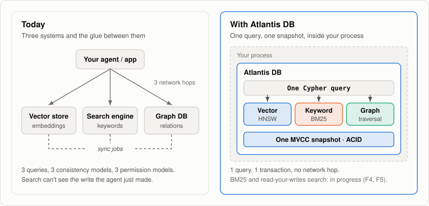
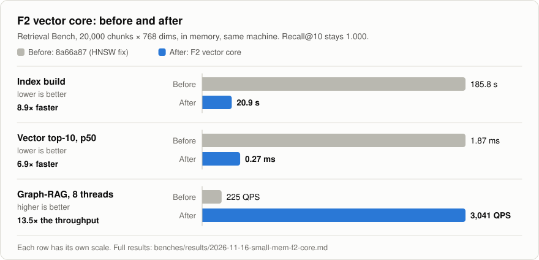
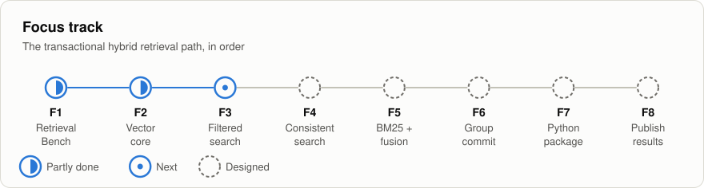
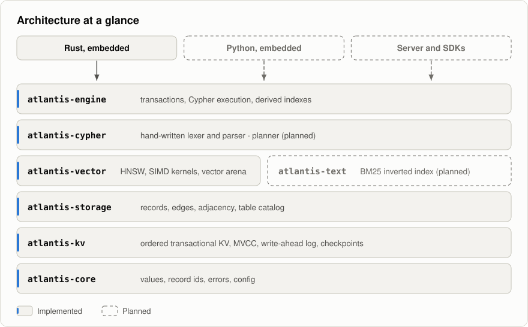

<div align="center">

# Atlantis DB

### The embedded Cypher database for agent memory and GraphRAG

Filtered vector search, full-text ranking and graph expansion in **one query**,
on **one ACID snapshot**, **inside your process**. Built in Rust.

[](#license)
[](https://www.rust-lang.org)
[](docs/25-implementation-roadmap.md)
[](#join-us)

[Why Atlantis](#why-atlantis-db) · [Quick start](#quick-start) · [Benchmarks](#benchmarks) ·
[Roadmap](#roadmap) · [Architecture](docs/02-architecture.md) · [**Join us**](#join-us)

</div>

---

```cypher
BEGIN;
// An agent stores a memory...
CREATE (:Memory {user: $user, text: $text, embedding: $vec});

// ...and in the same transaction retrieves what matters for this user:
// semantic + keyword search, filtered inside the index, then graph context.
CALL db.search.hybrid({text: 'memory_text', vector: 'memory_vec'}, $q, $qvec, 10)
  YIELD node, score
  WHERE node.user = $user
MATCH (node)-[:ABOUT]->(:Entity)-[:RELATED*1..2]->(ctx)
RETURN node.text, score, collect(DISTINCT ctx.name) AS context;
COMMIT;
```

Today that takes a vector store, a search engine, a graph database, sync jobs between
them and three permission models. **Atlantis DB makes it one query, one transaction,
one library.** The query above is the target design; [what runs today](#status) is
listed below.

<picture>
  <source media="(prefers-color-scheme: dark)" srcset="docs/assets/one-query.dark.svg">
  
</picture>

## Why Atlantis DB

| | |
|---|---|
| **One query, three retrieval modes** | Vector similarity, BM25 keyword ranking and multi-hop graph traversal compose in standard Cypher. No glue code, no second query language. |
| **Filters that keep recall** | Per-user, per-tenant and ACL filters are applied *during* the HNSW search, so recall holds when only 1% of the data matches, the normal case for agent memory and B2B catalogs. |
| **Search that obeys transactions** | Every index answers at the reader's MVCC snapshot and sees the transaction's own writes. An agent can read back what it just wrote, and never acts on a result the database would not commit. |
| **Embedded first** | A Rust library today, a Python package next: no server, no network hop, no cluster to run. The same engine is designed to scale out to a server and a cluster later. |
| **Open core, Apache-2.0** | The whole engine, including the hybrid retrieval path, is open source and stays that way. |

### How it compares

| | Atlantis DB | SurrealDB | LadybugDB (Kuzu fork) | HelixDB | FalkorDB | Neo4j |
|---|---|---|---|---|---|---|
| Embedded library | **Yes** | Yes | Yes | No | No | No |
| Standard Cypher | **Yes** | No (SurrealQL) | Yes | No (HelixQL) | Yes | Yes |
| Vector + full-text + graph in one query | Target | Yes | Via extensions | — | Yes | Yes |
| Search sees the writing transaction | **Target** | — | — | — | — | — |

"—" means not verified yet. Every claim is checked in our public benchmark harness
before it is made. See [Positioning & Performance Targets](docs/26-positioning-and-targets.md).

## Status

**Pre-release.** The foundations are real and tested. The headline features are being
built in the open, and this is the best time to shape them.

| Works today | In progress (focus track) |
|---|---|
| Embedded engine, in memory or on disk with a write-ahead log and crash recovery | Snapshot-consistent, read-your-writes search (F4) |
| MVCC transactions: snapshot and serializable isolation (configurable default), retry on conflict, group commit | Persisted index images: open 1M vectors in under a second (F4) |
| Cypher: `MATCH` (multi-hop, variable length, paths), `OPTIONAL MATCH`, `CREATE`, `MERGE`, `SET`, `REMOVE`, `DELETE`, `WITH`, `UNWIND`, `UNION`, aggregation, `BEGIN`/`COMMIT` | BM25 full-text and `db.search.hybrid` with rank fusion (F5) |
| Record model: namespaces, tables, documents, record links, edge tables | Per-database commit sequencer |
| HNSW vector index (SIMD kernels, parallel build, per-index locks) with `CREATE VECTOR INDEX` and `db.vector.search` | Embedded Python package (F7) |
| Filtered vector search: `YIELD ... WHERE node.field = $x` runs inside the index, recall@10 1.00 at 1% selectivity | Faster vector core: SQ8 quantization, AVX-512 and NEON |
| Retrieval Bench harness with exact ground truth | Competitor adapters for the benchmark |
| Property indexes (range, nested, multikey, composite) and `UNIQUE` / `NOT NULL` / `NODE KEY` constraints, with index seeks, index joins and `EXPLAIN` |  |

The full plan is in the [Implementation Roadmap](docs/25-implementation-roadmap.md).

## Quick start

Atlantis DB is not on crates.io yet. You need Rust 1.89 or newer.

```bash
git clone https://github.com/tristanseltec/atlantis-db
cd atlantis-db
cargo test --workspace
```

Use it from your project:

```toml
[dependencies]
atlantis-db = { path = "../atlantis-db/crates/atlantis-db" }
tokio = { version = "1", features = ["full"] }
```

```rust
use atlantis_db::{Engine, Value};

#[tokio::main]
async fn main() -> Result<(), atlantis_db::Error> {
    let engine = Engine::open("./my_atlantis_db").await?;

    engine.execute(
        "CREATE VECTOR INDEX doc_vec FOR (d:Doc) ON (d.embedding)
         OPTIONS {dimension: 3, metric: 'cosine'}",
        &[],
    ).await?;
    engine.execute(
        "CREATE (:Doc {title: 'Graphs', embedding: $v})-[:CITES]->(:Doc {title: 'Vectors'})",
        &[("v", Value::Vector(vec![0.9, 0.1, 0.0]))],
    ).await?;

    // Vector search, then follow the graph.
    let rs = engine.execute(
        "CALL db.vector.search('doc_vec', $q, 5) YIELD node, score
         MATCH (node)-[:CITES]->(cited)
         RETURN node.title AS doc, cited.title AS cites, score",
        &[("q", Value::Vector(vec![1.0, 0.0, 0.0]))],
    ).await?;
    for row in rs.rows() {
        println!("{:?} cites {:?}", row.get_string("doc"), row.get_string("cites"));
    }

    // The Rust record API and Cypher share one ACID store.
    engine.transaction(|tx| {
        let rs = tx.execute("MATCH (d:Doc) RETURN count(d) AS n", &[])?;
        assert_eq!(rs.rows().next().and_then(|r| r.get_int("n")), Some(2));
        Ok(())
    }).await?;

    engine.shutdown().await?; // optional: commits are already durable
    Ok(())
}
```

More in [Getting Started](docs/01-getting-started.md), the
[API Reference](docs/21-api-reference.md) and the [Query Cookbook](docs/23-query-cookbook.md).

## Benchmarks

We publish the harness, not just the numbers. The
[**Atlantis Retrieval Bench**](benches/retrieval/README.md) generates a deterministic
corpus, computes exact ground truth, and measures recall, latency, concurrency,
mixed read/write load and read-your-writes. Each system declares what it does natively,
so nothing is compared silently.

```bash
cargo run --release -p atlantis-retrieval-bench -- --scale small --out benches/results
```

It has already earned its keep. The first run found HNSW recall@10 of **0.22** at
20,000 × 768. The cause was a graph-connectivity bug, now fixed and pinned by
regression tests: **recall@10 is 1.00**. The next step (F2) made the vector core fast
without giving any of that recall back:

<picture>
  <source media="(prefers-color-scheme: dark)" srcset="docs/assets/bench-f2.dark.svg">
  
</picture>

<details>
<summary>The numbers as a table</summary>

| Retrieval Bench, small (20,000 × 768), in memory | Before (`8a66a87`) | Vector core | + parallel build |
|---|---|---|---|
| Index build | 185.8 s | 20.9 s | 5.0 s |
| Vector top-10, p50 / p99 | 1.87 / 2.90 ms | 0.27 / 0.63 ms | 0.26 / 0.46 ms |
| Recall@10 | 1.000 | 1.000 | 1.000 |
| Graph-RAG, 8 threads | 225 QPS | 3,041 QPS | 4,168 QPS |
| Graph-RAG, 8 threads + writes | 167 QPS | 1,411 QPS | 2,729 QPS |

At 100,000 × 768 the parallel build takes 27 s and top-10 p50 is 0.24 ms at recall 1.000.
Reports: [`f2-core`](benches/results/2026-11-16-small-mem-f2-core.md),
[`parallel-build`](benches/results/2026-11-16-small-mem-parallel-build.md),
[`medium`](benches/results/2026-11-16-medium-mem-parallel-build.md).

</details>

Filtered search (F3) then moved the filter into the index. When 1% of the records match
(one user out of 100), filtering an over-fetched result reached recall@10 **0.09**, with
every query short of 10 rows. With the `WHERE` pushed into the search it is **1.00**, at
p50 0.15 ms ([report](benches/results/2026-11-16-small-mem-f3-filtered.md)).

What's left before the targets below: persisted index images,
and getting writes off the search path (F4, F6).

| Target (1M chunks × 768, 1% filter, 8 threads under write load) | Goal |
|---|---|
| Hybrid query: filtered vector + BM25 + 2-hop expansion | p50 ≤ 3 ms, p99 ≤ 8 ms |
| Filtered recall@10 at 1% selectivity | ≥ 0.95 |
| Write → searchable | Same transaction |
| Unfiltered vector top-10 | ≤ 2 ms p50 at recall ≥ 0.95 |
| Durable ingest | ≥ 50,000 records/s |
| Open a 1M-vector database | < 1 s |

Current numbers and the gaps between them and the targets are tracked in
[docs/26](docs/26-positioning-and-targets.md#retrieval-bench-baseline-2026-11-16).

## Roadmap

<picture>
  <source media="(prefers-color-scheme: dark)" srcset="docs/assets/roadmap.dark.svg">
  
</picture>

| Step | What | Status |
|---|---|---|
| **F1** | Retrieval Bench: corpus, ground truth, workloads, report | Done for Atlantis; competitor adapters open |
| **F2** | Vector core: HNSW correctness, SIMD, contiguous storage, per-index locks, SQ8 | Correctness, SIMD, arena, locks and parallel build done (7× faster search, 37× faster build); SQ8 open |
| **F3** | Filtered search inside HNSW, with predicate pushdown from Cypher | Done: filtered recall@10 0.09 → 1.00 at 1% selectivity |
| **F4** | Versioned index entries, transaction overlay, persisted index images | Next |
| **F5** | BM25 (`atlantis-text`) and `db.search.hybrid` | Designed |
| **F6** | Group commit | Done: durable commits scale with writers (204/s → 6,198/s at 64), reads never wait on fsync |
| **F7** | Embedded Python package (PyO3) | Designed |
| **F8** | Publish benchmark results against competitors | — |

After the focus track: RocksDB backend, schema and secondary indexes, a cost-based
planner, change feeds and live queries, the server, and SDKs. The first vertical is
[commerce for humans and agents](docs/27-commerce.md).

## Join us

**Atlantis DB is looking for collaborators.** The architecture is designed, the
foundations are tested, and the benchmark tells us exactly where we stand. What's left
is some of the most interesting work in databases right now, at a stage where your
contributions shape the core.

### Where you can make a difference

| Area | Good first steps | You'll enjoy this if you like |
|---|---|---|
| **Vector search** (`atlantis-vector`) | AVX-512 and NEON kernels, SQ8 quantization with re-ranking, a query worker pool | Performance engineering, ANN algorithms |
| **Filtered search** | Push down labels, nested fields and `OR`; property indexes behind allow sets | Algorithms, research papers made real |
| **Full-text** (`atlantis-text`, new crate) | Analyzers, inverted index, BM25, rank fusion | Information retrieval |
| **Query engine** (`atlantis-cypher`, `atlantis-engine`) | Predicate pushdown, a first planner, batched execution, `EXPLAIN` | Compilers, query optimization |
| **Storage** (`atlantis-kv`) | RocksDB backend, the per-database commit sequencer, versioned index entries | Transactions, durability, MVCC |
| **Python** (`atlantis-py`, new crate) | PyO3 bindings, NumPy buffers, a LangChain / LlamaIndex integration | Developer experience, the AI ecosystem |
| **Benchmarks** (`benches/retrieval`) | Adapters for SurrealDB, LadybugDB, FalkorDB, Neo4j, Qdrant + Neo4j | Fair, reproducible measurement |
| **Commerce** ([docs/27](docs/27-commerce.md)) | Reference schema, dataset generator, MCP tool gateway | Product building, agentic commerce |
| **Docs and examples** | RAG and agent-memory examples, tutorials, cookbook recipes | Teaching, writing |

Design partners are welcome too: if you run RAG, agent memory or B2B catalog search
and want a say in what gets built, open an issue and tell us about your workload.

### How to start

1. Read [Architecture](docs/02-architecture.md) and the
   [roadmap priorities](docs/25-implementation-roadmap.md#priorities).
2. Build and test: `cargo test --workspace`. Run the bench at `--scale tiny`.
3. [Open an issue](https://github.com/tristanseltec/atlantis-db/issues) saying what you'd
   like to take on, or ask a question. We'll help you find a first task that fits.
4. Send a pull request. Small and focused is best; benchmark numbers are a plus for
   performance work.

### Conventions

- `cargo fmt` and `cargo clippy --all-targets -- -D warnings` must be clean.
- Public items have rustdoc comments; new behaviour comes with tests.
- Performance changes report before/after numbers from `cargo bench` or the Retrieval Bench.
- No `unsafe` without a `// SAFETY:` comment explaining why it holds.
- Docs describe what the code does today and mark planned work with its phase.

## Architecture at a glance

<picture>
  <source media="(prefers-color-scheme: dark)" srcset="docs/assets/architecture.dark.svg">
  
</picture>

The design (hybrid retrieval path, commerce layer, editions) is in
[Architecture](docs/02-architecture.md). All documentation starts at the
[docs index](docs/README.md).

## Editions

Atlantis DB is open core. **Everything in this repository is Apache-2.0 and stays that
way**, including every engine feature on the hybrid retrieval path. A future
commercial edition will add operational features: replication and high availability,
SSO and audit, point-in-time recovery, larger-than-memory indexes, and a commerce
product. These plug into open extension traits, so the core never carries licence
checks and your data moves between editions without migration.
[Details](docs/02-architecture.md#editions-and-extension-points-planned).

## License

Apache License, Version 2.0. Contributions are accepted under the same license.

<div align="center">

**If agent memory, GraphRAG or the database internals behind them excite you, [come build Atlantis with us](#join-us).**

</div>
